# COBOL Frontend

A COBOL web server for an example GOV.UK service, **Apply for a fishing rod licence**, plus a site generated from the [GOV.UK Frontend](https://design-system.service.gov.uk/) 6.6.0 test fixtures.

The licence journey is rendered by COBOL. Answers are kept in memory for the life of the process and tied to a `session` cookie. The service does not take payment, send email, or issue a real licence. The fixture catalogue, fees page, CSS, JavaScript, fonts, and images are static files. A Node script runs at image build time, reads each component's `fixtures.json`, and writes one HTML page per fixture inside the GOV.UK page template. Interactive components are started with `initAll()`.

## How COBOL is used

Every HTTP request is handled by one GnuCOBOL program, `govuk-server`. `make` compiles the programs in `src/` with the small C file `c/posix_io.c` into that binary. Docker does the same compile inside the image. Node is used to generate the static site and to run the fixture checks. It is not part of the running server.

```mermaid
%% Generated by https://gitdiagram.com/nooshu/cobol-frontend
flowchart TD

subgraph group_http["HTTP Server"]
  node_server["Request Server<br/>[server.cbl]"]
  node_parser["Request Parser<br/>[http-request.cbl]"]
  node_response["HTTP Response<br/>[http-response.cbl]"]
end

subgraph group_journey["Licence Journey"]
  node_journey["Licence Routes<br/>[journey.cbl]"]
  node_sessions[("In-memory Sessions<br/>[journey.cbl]")]
  node_partials["Page Partials<br/>[build-site.mjs]"]
end

subgraph group_content["Static Content"]
  node_static["Static File Service<br/>[static-file.cbl]"]
  node_mime["MIME Types<br/>[mime-types.cbl]"]
  node_sitegen["Site Generator<br/>[build-site.mjs]"]
  node_fixture_catalogue["Fixture Catalogue<br/>[build-site.mjs]"]
  node_fees["Fees Page<br/>[build-site.mjs]"]
  node_site_assets["Site Assets<br/>[build-site.mjs]"]
end

subgraph group_platform["POSIX I/O"]
  node_posix["POSIX I/O<br/>[posix_io.c]"]
end

node_browser(("Browser"))

node_browser -->|"sends request"| node_server
node_server -->|"parses request"| node_parser
node_server -->|"dispatches routes"| node_journey
node_server -->|"dispatches files"| node_static
node_server -->|"writes response"| node_response
node_journey -->|"reads and updates"| node_sessions
node_journey -->|"reads HTML"| node_partials
node_static -->|"chooses content type"| node_mime
node_sitegen -->|"generates pages"| node_fixture_catalogue
node_sitegen -->|"generates page"| node_fees
node_sitegen -->|"writes partials"| node_partials
node_sitegen -->|"copies assets"| node_site_assets
node_server -->|"uses socket I/O"| node_posix
node_static -->|"uses file operations"| node_posix

click node_server "https://github.com/nooshu/cobol-frontend/blob/main/src/server.cbl"
click node_parser "https://github.com/nooshu/cobol-frontend/blob/main/src/http-request.cbl"
click node_response "https://github.com/nooshu/cobol-frontend/blob/main/src/http-response.cbl"
click node_journey "https://github.com/nooshu/cobol-frontend/blob/main/src/journey.cbl"
click node_sessions "https://github.com/nooshu/cobol-frontend/blob/main/src/journey.cbl"
click node_partials "https://github.com/nooshu/cobol-frontend/blob/main/scripts/build-site.mjs"
click node_static "https://github.com/nooshu/cobol-frontend/blob/main/src/static-file.cbl"
click node_mime "https://github.com/nooshu/cobol-frontend/blob/main/src/mime-types.cbl"
click node_sitegen "https://github.com/nooshu/cobol-frontend/blob/main/scripts/build-site.mjs"
click node_fixture_catalogue "https://github.com/nooshu/cobol-frontend/blob/main/scripts/build-site.mjs"
click node_fees "https://github.com/nooshu/cobol-frontend/blob/main/scripts/build-site.mjs"
click node_site_assets "https://github.com/nooshu/cobol-frontend/blob/main/scripts/build-site.mjs"
click node_posix "https://github.com/nooshu/cobol-frontend/blob/main/c/posix_io.c"

classDef toneNeutral fill:#f8fafc,stroke:#334155,stroke-width:1.5px,color:#0f172a
classDef toneBlue fill:#dbeafe,stroke:#2563eb,stroke-width:1.5px,color:#172554
classDef toneAmber fill:#fef3c7,stroke:#d97706,stroke-width:1.5px,color:#78350f
classDef toneMint fill:#dcfce7,stroke:#16a34a,stroke-width:1.5px,color:#14532d
classDef toneRose fill:#ffe4e6,stroke:#e11d48,stroke-width:1.5px,color:#881337
classDef toneIndigo fill:#e0e7ff,stroke:#4f46e5,stroke-width:1.5px,color:#312e81
classDef toneTeal fill:#ccfbf1,stroke:#0f766e,stroke-width:1.5px,color:#134e4a
class node_server,node_parser,node_response,node_browser toneBlue
class node_journey,node_sessions,node_partials toneAmber
class node_static,node_mime,node_sitegen,node_fixture_catalogue,node_fees,node_site_assets toneMint
class node_posix toneRose
```



`c/posix_io.c` is the only non-COBOL code on the request path. It hides the differences between macOS and Linux for listening sockets, reading and writing bytes, file size, `realpath`, and `/dev/urandom`. The COBOL programs call those functions as `GWS_LISTEN`, `GWS_ACCEPT`, `GWS_READ`, `GWS_WRITE`, `GWS_CLOSE`, `GWS_OPEN_FILE`, `GWS_FILE_SIZE`, `GWS_REALPATH`, and `GWS_RANDOM`.

The programs share one request and response record, defined in `copy/http.cpy`. Defaults for `PORT` and `DOCUMENT_ROOT` live in `copy/config.cpy`.

| Program | What it does |
| --- | --- |
| `GOVUK-SERVER` (`src/server.cbl`) | Reads `PORT` and `DOCUMENT_ROOT`, accepts one connection at a time, reads the headers and any POST body, then calls the other programs. |
| `HTTP-REQUEST` (`src/http-request.cbl`) | Reads the request line into a method, path, and query string, and rejects `..` segments. |
| `JOURNEY` (`src/journey.cbl`) | Owns the fishing rod licence routes. It keeps up to 16 sessions in memory, sets the `session` cookie, validates each answer, and writes the HTML. |
| `STATIC-FILE` (`src/static-file.cbl`) | Serves a file under the document root. A directory is served from `index.html`. `realpath` has to stay inside that root. |
| `MIME-TYPES` (`src/mime-types.cbl`) | Chooses `Content-Type` from the file extension. |
| `HTTP-RESPONSE` (`src/http-response.cbl`) | Writes the status line, headers, and body, including redirects, the session cookie, and streamed files. |

For a licence page, `JOURNEY` writes the document head itself, then appends chrome from `site/partials/` (`top.html`, `top-cy.html`, and `bottom.html`) and the question or confirmation markup. Those partials, the fixture pages, the fees page, and `/robots.txt` are written by `scripts/build-site.mjs` before the server starts. COBOL reads them as files. It does not call Node while a request is in progress.

Routes COBOL answers itself are `/`, `/cy`, `/licence-length`, `/name`, `/date-of-birth`, `/where-you-will-fish`, `/email`, `/check-answers`, and `/confirmation`. Any other path is a static file, or a 404 when that file is missing.

## Run with Docker

Docker is the supported way to run the server. The image builds the fixture site, compiles the COBOL program with GnuCOBOL, and listens on port 8080.

```sh
docker compose up --build
```

When the container is listening, the log prints [http://localhost:8080](http://localhost:8080). Start now walks through licence length, name, date of birth, where you will fish, and email, then check your answers and a confirmation reference. `/cy` is the Welsh start page. The rest of the journey is in English. Invalid answers stay on the same question. `/fees` lists the example prices. `/components` is the fixture catalogue. Fixtures marked hidden by GOV.UK Frontend are listed separately, because they are not visually distinct. Each component's original `fixtures.json` is served under `/fixtures/`.

## Tests

Both commands talk to a running server. `BASE_URL` overrides the default `http://127.0.0.1:8080`.

```sh
npm run test:fixtures
./scripts/smoke-test.sh
```

`npm run test:fixtures` starts the server when nothing is already listening. It runs `docker compose up -d --build`, waits until the site responds, and leaves the container running. It then reads every fixture from the pinned `govuk-frontend` package and requests the matching page under `/components/`. A fixture passes when the response is HTTP 200 and the body contains that fixture's official HTML. The command prints one line per component as it finishes:

```
✓ Accordion            13 fixtures passed
✓ Back link            7 fixtures passed
…
39 components passed (725 fixtures)
```

A failed component prints the fixture that did not match, and the command exits with status 1.

`./scripts/smoke-test.sh` expects the server to be up already. It checks the start page and its session cookie, the Welsh start page, the catalogue, the fees table, `robots.txt`, a button fixture, the stylesheet, the JavaScript, and a font referenced by the CSS. It also checks a missing file (404), `POST` to a static page (405), and path traversal (400). It then walks the licence journey with one cookie: an empty licence length stays on the question with an error, valid answers reach check your answers, and accept and continue reaches a confirmation reference. Opening confirmation without that session redirects to the start page.

## Local build

The same binary can be compiled on Linux, or on macOS with GnuCOBOL installed. `sockaddr` and `stat` layouts stay in `c/posix_io.c`, so the COBOL code is the same on both.

```sh
npm ci
npm run build:site
make
DOCUMENT_ROOT=site PORT=8080 ./bin/govuk-server
```

## HTTP behaviour

The server handles one request at a time. Journey pages accept `GET`, `HEAD`, and `POST`. Other paths accept `GET` and `HEAD`, and reject `POST` with 405. Paths that leave the document root are refused. `PORT` defaults to 8080 and `DOCUMENT_ROOT` defaults to `site`. Journey HTML is not cached (`Cache-Control: no-store`). HTML responses send `X-Robots-Tag: noindex, nofollow`, and `/robots.txt` disallows every path.
